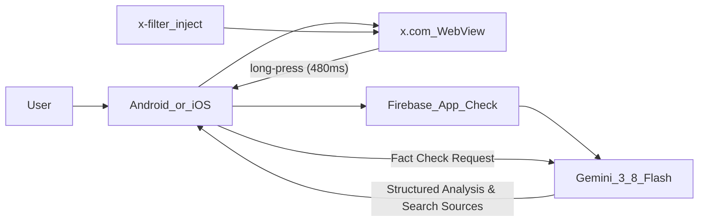

# Architecture

Robin is a native **Android** and **iOS** client that loads **x.com** in a WebView and injects shared filters so the timeline stays ad-light and defaults to Following (For You is optional in Settings). Robin uses a dedicated Firebase project (`robin-evergreen`) strictly for Firebase AI Logic (Gemini 3.8 Flash fact-checking protected by App Check). There is no Robin custom backend server or Firestore sync — X sign-in is the WebView cookie session.

## Goals

- Default to the **Following** / reverse-chronological timeline; Settings can switch to algorithmic **For You**.
- Hide promoted posts and other chrome that distracts from people you chose to follow.
- Long-press to fact-check any tweet with generative AI (`gemini-3.8-flash`), real-time Google Search grounding, and Media Bias/Fact Check (MBFC) publisher credibility.
- Keep optional analytics / crash reporting off by default for forks (empty config ⇒ disabled).

## High-level flow

## Components

| Piece | Role |
|-------|------|
| [`android/`](../android/) | Jetpack Compose (minSdk 33): `XWebFeedScreen` WebView + `assets/x-filter` inject. Fact-check bottom sheet via `GenerativeAIService` (Gemini 3.8 Flash) with App Check (`PlayIntegrity` in release, debug token in debug). Settings for text size, filter toggles, and X sign-out (cookie clear). Optional Sentry / Aptabase. See [`docs/webview-filter.md`](webview-filter.md) |
| [`ios/`](../ios/) | SwiftUI (iOS 18+): `XWebFeedView` WKWebView + `Resources/x-filter` inject (parity with Android). Fact-check bottom sheet via `GenerativeAIService` (Gemini 3.8 Flash) with App Check (`AppAttest` / `DeviceCheck` in release, debug token in debug). Settings for text size, filter toggles, and X sign-out (`WKWebsiteDataStore`). Optional Sentry / Aptabase. See [`docs/webview-filter.md`](webview-filter.md) |
| Fact-Checking & AI Logic | Native long-press bridge extracts tweet text, quote tweets, author, and embedded links. Queries `gemini-3.8-flash` via Firebase AI Logic with Google Search grounding and low thinking level for low latency. Evaluates credibility (1-10), verdict, 3-point summary, key findings with truth chips, independent corroborating sources, and local MBFC publisher rating |
| [`fastlane/`](../fastlane/) | Homebrew Fastlane: `android beta` (Play internal testing), `ios beta` (TestFlight), `beta_both`. Secrets stay in env / local paths — not in git |
| [`scripts/feed-credibility/`](../scripts/feed-credibility/) and [`web/feed-compare/`](../web/feed-compare/) | Local comparison of For You vs Following. A Chrome session reads both timelines (the public X API only has reverse-chronological Following). Posts are scored with the Simplifier credibility prompt. `node web/feed-compare/server.cjs` serves the UI on `127.0.0.1`. Not part of the shipped apps |
| [`scripts/benchmark-filter.cjs`](../scripts/benchmark-filter.cjs) | On-device filter benchmark. The in-app controls are debug-only. See [`docs/performance-benchmark.md`](performance-benchmark.md) |

### Fact Check & Generative AI Architecture

- **Model**: `gemini-3.8-flash` via Firebase AI Logic (`FirebaseAILogic` on iOS, `firebase-ai` on Android).
- **Thinking Level**: Low (`ThinkingLevel.LOW` / `thinkingLevel: .low`). Minimal is unsupported on 3.8 Flash.
- **Grounding**: Enabled with `Tool.googleSearch()` to search live web sources and fact-checking outlets.
- **Structured Outputs**: Strict JSON schema defining `credibilityScore` (1–10), `verdict`, `summaryPoints`, `keyFindings` (claim, status: confirmed/debunked/unverified/misleading/context_needed, explanation), and `independentSources` (title, url, domain, note).
- **App Check**: All generative AI requests are gated by Firebase App Check (`robin-evergreen`). Debug builds use registered debug tokens (`AppCheckDebugProviderFactory`), while production releases use Apple App Attest / DeviceCheck on iOS and Google Play Integrity on Android.
- **Publisher Credibility**: Local catalog lookup against Media Bias / Fact Check (MBFC) covering major news outlets, fact-checkers, state media, and questionable domains.

### Android native (Jetpack Compose)

- `XWebFeedScreen` — `x.com` WebView with injected `assets/x-filter` (force Following or For You from Settings, hide promoted / page header; boot cover via `RobinBoot.ready()`). In-feed Instagram-style caught-up marker indicates when the user has scrolled to the most recent post viewed in the previous visit. Long-press on any tweet article triggers native haptic vibration and displays `FactCheckSheet` modal bottom sheet. Top bar stays visible with a New post control (`/compose/post`); a back-to-top control appears near the top after scrolling. **Near-top auto-refresh:** on return to foreground, title tap while near top, and a foreground poll once the user has been idle ~20s — warm cache-bypassing load of `/home` under a snapshot of the old feed that crossfades away on boot-ready (cooldown from Settings Auto-refresh; default 5 min, Off disables auto). “Show N posts” is auto-clicked by filter-core when X paints it. Settings: text size (feed only, default 100% / max 200%), home feed (Following by time or For You), show or hide feed tabs (Following, Tech, etc.), show or hide live content, hide posts that include a user keyword as a whole word (`cat` does not hide `category`), cookie sign-out, and a link to the source repository. X’s compose FAB is always hidden in favor of the header New post control. Google/Apple SSO uses an in-app popup WebView (`onCreateWindow`) with `window.opener` for GIS. Non-X web links open in Chrome Custom Tabs.
- See [webview-filter.md](webview-filter.md) and [mobile.md](mobile.md).

### iOS native (SwiftUI)

- `XWebFeedView` — `x.com` WKWebView with injected `Resources/x-filter` (force Following or For You from Settings, hide promoted / page header; Minimal Twitter MIT). In-feed Instagram-style caught-up marker indicates when the user has scrolled to the most recent post viewed in the previous visit. Long-press on any tweet article triggers native haptic feedback (`UIImpactFeedbackGenerator(.medium)`) and presents `FactCheckResultSheet` sheet. A native boot cover hides the WebView until filter-core settles and posts `mtBoot`. Native chrome stays visible with a New post control (`/compose/post`); a back-to-top control appears near the top after scrolling. **Near-top auto-refresh:** on return to foreground, title tap while near top, and a poll while foregrounded near the top once the user has been idle ~20s — warm cache-bypassing load of `/home` under a snapshot of the old feed that crossfades away on boot-ready (cooldown from Settings Auto-refresh; default 5 min, Off disables auto). On Mac (`isiOSAppOnMac`), the poll also continues while `.inactive` (visible non-key window). “Show N posts” is auto-clicked by filter-core when X paints it. Settings gear: text size (`FontScaleStore` → feed `html` `-webkit-text-size-adjust` only, default 100% / max 200%), home feed (Following by time or For You), show or hide feed tabs (Following, Tech, etc.), show or hide live content, hide posts that include a user keyword as a whole word (`cat` does not hide `category`), X sign-out via `WKWebsiteDataStore`, and a link to the source repository. X’s compose FAB is always hidden in favor of the header New post control. Google/Apple SSO uses an in-app child `WKWebView` so `window.opener` works. Non-X web links open in `SFSafariViewController`.
- See [webview-filter.md](webview-filter.md) and [mobile.md](mobile.md).

## Configuration

| Setting | Where |
|---------|--------|
| Firebase project | `robin-evergreen` (Project ID: `robin-evergreen`) |
| Android Firebase config | `android/app/google-services.json` |
| iOS Firebase config | `ios/Robin/GoogleService-Info.plist` |
| Android SDK path | `android/local.properties` (`sdk.dir`) — gitignored |
| Android Sentry DSN | `android/local.properties` (`sentry.dsn`) or env `SENTRY_DSN` — never commit live values |
| Android Aptabase | `android/local.properties` (`aptabase.appKey`, `aptabase.host`) or env — empty ⇒ off |
| iOS Sentry / Aptabase | `ios/Config.xcconfig` — never commit live values |
| Play upload keystore | `android/keystore.properties` — gitignored |

## Out of scope

- Hosted SPA / Firebase Auth / Firestore timeline sync
- Robin-operated X API polling or RSS
- Shared / multi-member backend feeds
- Streaming / Account Activity APIs
